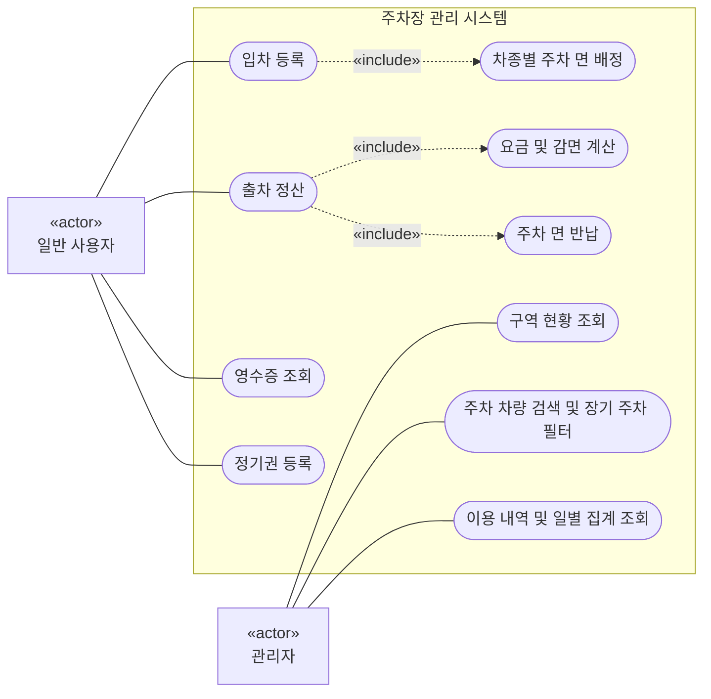
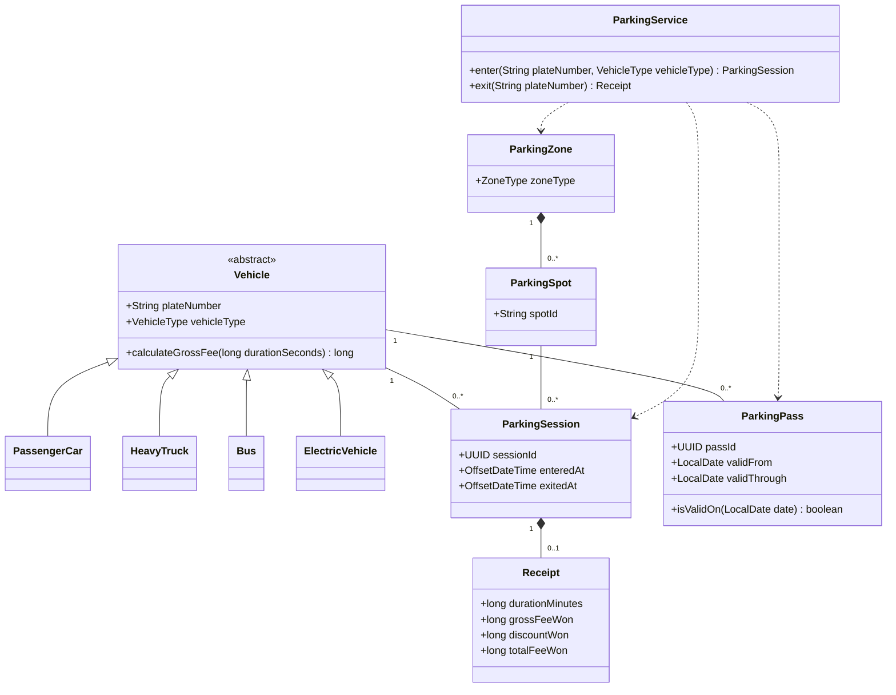

# 주차장 관리 시스템 작업 명세서 (SRS)

## 1. 목적 및 범위

본 시스템은 차량 입차 시 차종에 맞는 주차 면을 배정하고, 출차 시 주차 시간과 할인 정책을 반영한 요금을 정산한다. 사용자는 입·출차, 영수증 확인, 정기권 등록을 할 수 있고 관리자는 주차 현황과 이용 내역을 조회한다. 요금 계산과 영수증 제공까지 구현 범위에 포함한다. 결제 수단 연동, 차량 번호 자동 인식, 충전기 제어는 범위 외다.

과제의 `Vehicle.java`를 차종 모델의 기반으로 사용한다. 차종별 요금 오버라이딩, 구역 자동 배정, 정기권, 검색·집계 및 재시작 복원까지 기능을 확장한다.

## 2. 기능 요구사항

| ID | 기능 | 입력 및 처리 | 성공 결과와 예외 |
| --- | --- | --- | --- |
| FR-01 | 입차 | 차량 번호와 차종을 받아 진행 중인 기록을 확인한 뒤 해당 구역의 빈 면을 하나 배정한다. 여러 면이 비어 있으면 면 ID 오름차순으로 선택한다. | 기록 ID와 배정 면을 반환한다. 중복 입차 또는 해당 구역 만차면 상태 변경 없이 거절한다. |
| FR-02 | 출차 | 차량 번호로 진행 중인 기록을 찾고, 출차 시각을 기준으로 주차 시간과 요금을 계산한다. | 출차 기록과 영수증을 저장하고 주차 면을 반납한다. 진행 중인 기록이 없으면 거절한다. |
| FR-03 | 영수증 조회 | 주차 기록 ID로 완료된 정산을 조회한다. | 차량 번호, 입·출차 시각, 주차 시간, 할인 전 요금, 할인액 및 최종 요금을 반환한다. 존재하지 않거나 미정산 상태인 기록은 오류로 처리한다. |
| FR-04 | 정기권 등록 | 차량 번호, 시작일, 종료일을 등록한다. | 기간이 유효하면 정기권 ID를 반환한다. 날짜가 역전되거나 종료일이 이미 지났거나 같은 차량의 등록 기간이 겹치면 거절한다. |
| FR-05 | 구역 현황 | 구역별 총 주차 면, 사용 중인 면, 빈 면과 각 면의 상태를 조회한다. | 모든 구역에서 총 면수는 사용 중인 면수와 빈 면수의 합과 같다. |
| FR-06 | 주차 중 차량 검색 | 차량 번호 일부와 최소 주차 시간(분)을 선택적으로 입력한다. 두 조건을 함께 주면 모두 충족하는 진행 중 기록을 조회한다. | 입차 시각과 배정 면을 포함한 목록을 반환한다. 일치 항목이 없으면 빈 목록을 반환한다. |
| FR-07 | 이용 내역 및 집계 | 출차일 범위와 선택적 차량 번호로 완료 기록을 조회한다. | 상세 기록 및 출차일별 건수와 최종 요금 합계를 반환한다. 집계에는 동일한 검색 조건을 적용한다. |
| FR-08 | 기록 복원 | 입·출차 및 정기권 등록 결과를 영속 저장한다. | 재시작 후 진행 중인 차량, 주차 면 점유, 영수증 및 정기권을 복원한다. |

## 3. 데이터 규격과 처리 규칙

| 데이터 | 필드 (자료형) | 제약 |
| --- | --- | --- |
| 차량 | `plateNumber` (문자열), `vehicleType` (열거형) | 차량 번호는 공백 제거·영문 대문자 변환 후 1~20자이며 한글 완성형·영문 대문자·숫자를 허용한다. |
| 구역·주차 면 | `zoneType` (열거형), `spotId` (문자열) | 면 ID는 전체 주차장에서 고유하다. 면별 점유 여부는 진행 중 기록으로 결정한다. |
| 주차 기록 | `sessionId` (UUID 문자열), `plateNumber`, `vehicleType`, `spotId`, `enteredAt`, `exitedAt` (시각) | `exitedAt`이 없으면 진행 중이다. 차량과 면은 각각 진행 중 기록을 최대 하나만 가진다. 출차 시각은 입차 시각 이상이어야 한다. |
| 정기권 | `passId` (UUID 문자열), `plateNumber`, `validFrom`, `validThrough` (날짜) | 시작일과 종료일을 모두 포함한다. 차량 번호별 유효 기간 중복을 금지한다. |
| 영수증 | `sessionId` (UUID 문자열), `durationMinutes`, `grossFeeWon`, `discountWon`, `totalFeeWon` (정수), `discountKind` (열거형) | 완료 기록당 한 건을 저장한다. 금액은 0 이상의 원 단위이며 최종 요금은 할인 전 요금에서 할인액을 뺀 값이다. |

- 차종과 구역의 대응은 `CAR → GENERAL`, `TRUCK/BUS → LARGE`, `EV → EV_CHARGING`으로 고정한다.
- 시각은 ISO 8601 오프셋 포함 문자열, 날짜는 `YYYY-MM-DD`로 교환한다. 검색 기간, 정기권 유효일, 일별 집계의 날짜 경계는 모두 한국 표준시를 사용한다.
- 요금은 차종별 기본요금, 기본 제공 시간, 초과 1시간당 요금 및 해당 할증에 따라 계산한다. 초과 시간은 시작된 시간 단위로 올림한다. 영수증의 주차 시간은 실제 경과 시간을 분 단위로 올림한다.
- 할인 정책 초안은 출차일에 유효한 정기권 감면을 우선 적용하고, 적용할 정기권이 없으면 전기차 할인을 적용하는 방식이다. 만료 정기권은 감면 대상에서 제외하며 정상 출차를 허용한다. 기본요금·포함 시간·추가요금·할증·감면율의 수치는 구현 전 팀에서 확정한다.
- 정산 당시 계산 결과를 영수증에 저장해 요금표 변경 후에도 과거 내역이 유지되도록 한다.

## 4. 핵심 인터페이스 규약

프론트엔드와 백엔드가 공유할 HTTP/JSON 계약 초안이다. 요청과 응답은 UTF-8을 사용한다. 서버가 입·출차 시각을 부여하며 프론트엔드는 서버의 오류 코드를 사용자 안내 문구에 연결한다.

| 메서드 및 경로 | 요청 | 성공 응답 |
| --- | --- | --- |
| `POST /api/parking/entries` | `{plateNumber, vehicleType}` | `201` 주차 기록 |
| `POST /api/parking/exits` | `{plateNumber}` | `200` 완료 주차 기록과 영수증 |
| `GET /api/parking/sessions/{sessionId}/receipt` | 경로에 주차 기록 ID | `200` 완료 기록과 영수증 |
| `POST /api/passes` | `{plateNumber, validFrom, validThrough}` | `201` 정기권 기록 |
| `GET /api/admin/zones` | 없음 | `200` 구역별 `{zoneType, capacity, occupied, available, spots}` 목록 |
| `GET /api/admin/active-sessions` | 선택 쿼리 `plateContains`, `minMinutes` (0 이상의 정수) | `200` 진행 중 주차 기록 목록 |
| `GET /api/admin/history` | 필수 쿼리 `from`, `to` (양끝 포함 날짜), 선택 쿼리 `plateNumber` (정확히 일치) | `200` `{sessions, dailyTotals}`. 일별 항목은 `{date, exitCount, totalFeeWon}`. |

오류 본문은 `{"code":"ZONE_FULL","message":"해당 구역에 빈 주차 면이 없습니다."}` 형식을 따른다.

| 상태 | 오류 코드 |
| --- | --- |
| 400 | `INVALID_INPUT` (필수값 누락, 지원하지 않는 차종, 잘못된 날짜·검색 범위) |
| 404 | `SESSION_NOT_FOUND`, `ACTIVE_SESSION_NOT_FOUND` |
| 409 | `ALREADY_PARKED`, `ZONE_FULL`, `PASS_OVERLAP`, `RECEIPT_NOT_READY` |
| 500 | `STORAGE_ERROR` (저장 실패 시 처리 완료로 응답하지 않음) |

### 4.1 프론트엔드 연동 응답 구조

Java 프론트엔드에서 사용하는 구체적인 JSON 구조다. 백엔드 연동 시 두 팀원이 필드명과 래퍼 구조를 확인한다.

- 출차 및 영수증 조회는 `{"session": {...}, "receipt": {...}}`를 반환한다. `session`은 3절의 주차 기록, `receipt`는 정산 결과이며 두 항목의 `sessionId`는 동일하다. 권장 할인 코드는 `NONE`, `PASS`, `EV`다.
- 입차 및 정기권 등록 성공 응답은 각각 주차 기록 객체와 정기권 객체를 직접 반환한다. 진행 중 기록의 `exitedAt`은 `null`이거나 생략된다.
- 구역 현황은 JSON 배열이다. 각 구역의 `spots`에는 `{"spotId":"E01","occupied":true}` 형식의 객체를 넣는다. 주차 중 차량 조회도 주차 기록 배열을 직접 반환한다. 이용 내역에서는 완료 주차 기록 배열과 일별 합계 배열을 `sessions`와 `dailyTotals`에 각각 넣는다. 결과가 없으면 해당 배열은 `[]`다.
- 요청이 시간 초과되면 서버에서 처리가 완료됐을 수도 있다. 프론트엔드는 변경 요청을 자동으로 재전송하지 않으며 재시도 전에 상태를 조회하도록 안내한다.

### 4.2 인터페이스 설계 근거

- **전달 방식** · 화면과 서버를 HTTP/JSON으로 연결한다. 프론트엔드는 Java 레코드로 응답을 읽고, 서버와 별도로 화면을 테스트할 때도 동일한 요청과 응답을 쓸 수 있다.
- **조회와 변경** · 상태를 변경하는 기능에 `POST`, 읽기 전용 기능에 `GET`을 사용한다. 중복 입차나 만차는 입력 형식이 유효해도 현재 주차 상태와 충돌하므로 `409`로 반환하고, 형식 오류는 `400`으로 구분한다.
- **정산의 책임** · 서버가 배정 면과 정산액을 결정한다. 출차 응답에 영수증을 포함하면 화면이 다시 조회할 필요 없이 결과를 표시할 수 있고, 같은 구조를 영수증 재조회에 사용해 기록의 일관성을 확인할 수 있다.
- **시간과 금액** · 시각에는 오프셋을 포함하고 검색 날짜의 기준은 한국 표준시로 통일한다. 금액은 서버가 계산한 정수 원 단위를 전달하므로 UI의 부동소수점 반올림에 의존하지 않는다.

## 5. UML 다이어그램

### 5.1 Use Case Diagram

액터와 유스케이스의 연관 관계를 실선으로 표현하고, 입·출차에 항상 수반되는 처리를 «include»로 표현한다.

### 5.2 Class Diagram

`ParkingSpot`의 0..* 연관은 누적 이력을 뜻한다. 같은 면의 진행 중 기록은 한 건으로 제한한다.

## 6. 품질 요구사항 및 인수 기준

- **데이터 일관성** · 입차 기록과 면 배정, 출차 기록과 영수증 및 면 반납은 각각 하나의 작업으로 처리한다. 마지막 한 면에 두 요청이 동시에 들어와도 한 건만 성공해야 한다.
- **저장 및 오류 처리** · 영속화 형식은 CSV를 후보로 두고 구현 전 결정한다. 저장 실패 시 부분 성공을 사용자에게 표시하지 않으며, 재시작 후 마지막으로 완료된 상태를 복원할 수 있어야 한다.
- **화면 피드백** · 사용자와 관리자 메뉴를 구분한다. 화면에 검색 결과가 없을 때와 요청에 실패했을 때를 구분해 안내한다.

| 검증 시나리오 | 인수 기준 |
| --- | --- |
| 전기차 구역 만차, 일반 구역에 빈 면 존재 | 전기차 입차는 `ZONE_FULL`로 실패하고 어느 구역의 점유도 바뀌지 않는다. |
| 동일 번호 재입차 및 마지막 면 동시 요청 | 중복 번호의 진행 중 기록은 하나만 존재하고 한 면을 두 차량이 동시에 점유하지 않는다. |
| 기본 시간 경계와 직후 출차 | 기본 시간까지 추가요금이 없고 경계 직후에는 첫 초과 시간 요금이 적용된다. |
| 정기권 만료일과 다음 날, 전기차 할인 중복 조건 | 종료일까지 정기권 감면을 적용하고 다음 날에는 정기권 감면을 제외한다. 정기권과 전기차 할인을 함께 적용하지 않는다. |
| 출차 및 재시작 | 출차 후 면을 다시 배정할 수 있으며 재시작 후 이력과 영수증의 금액이 유지된다. |
| 부분 번호·최소 시간으로 검색 및 날짜별 집계 | 검색 조건을 모두 충족한 차량만 반환하고 지정 기간의 건수와 요금 합계가 완료 기록과 일치한다. |

## 7. 구현 분담

- **김원섭 · 프론트엔드** · 사용자와 관리자 화면, 입·출차·정기권 입력, 구역 현황과 검색, 영수증 및 집계 표시, 입력과 오류 안내를 구현한다.
- **전승표 · 백엔드** · 차량 하위 클래스와 요금 계산, 구역 배정, 정기권, 영속화, 조회 및 집계 API를 구현한다.
- 두 팀원은 API 계약과 요금표를 확정한 뒤 정상·예외·재시작 시나리오를 함께 검증한다.

[프로젝트 제안서 · 이슈 #2](https://github.com/SWPJTeam/SW_project/issues/2) · [초기 제안 및 팀원 의견 · 이슈 #1](https://github.com/SWPJTeam/SW_project/issues/1)
